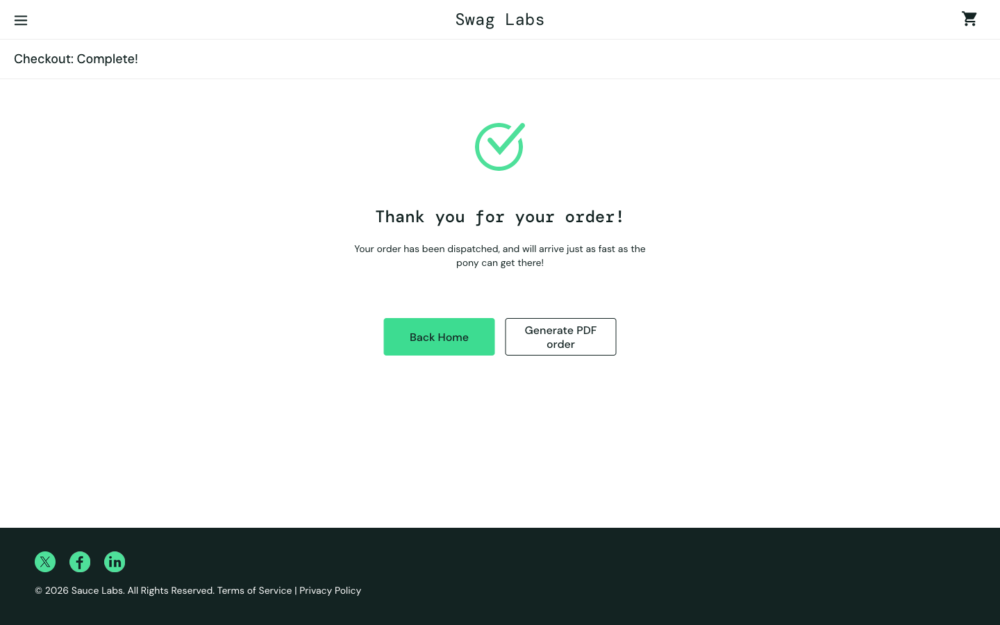
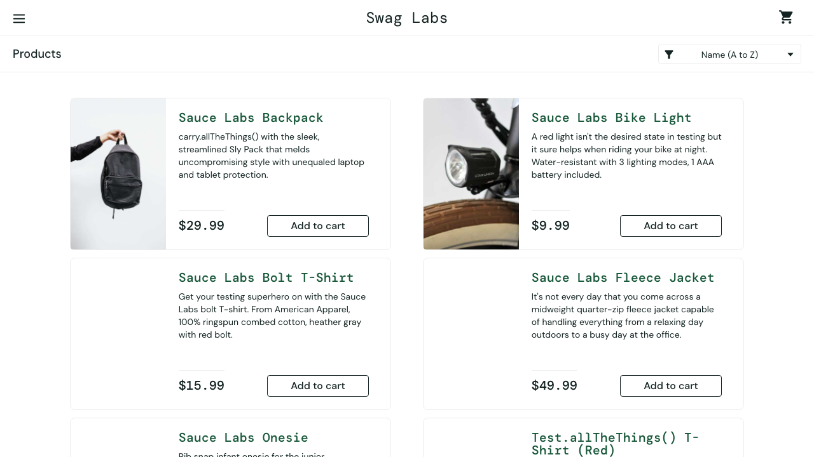
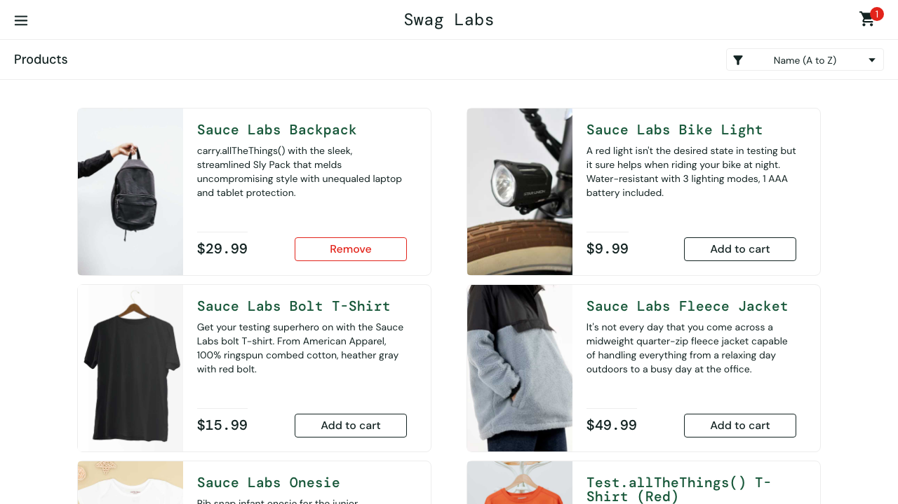
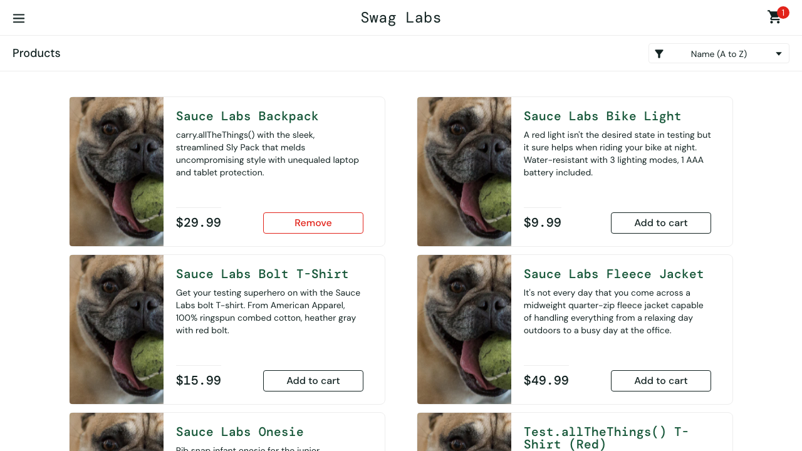
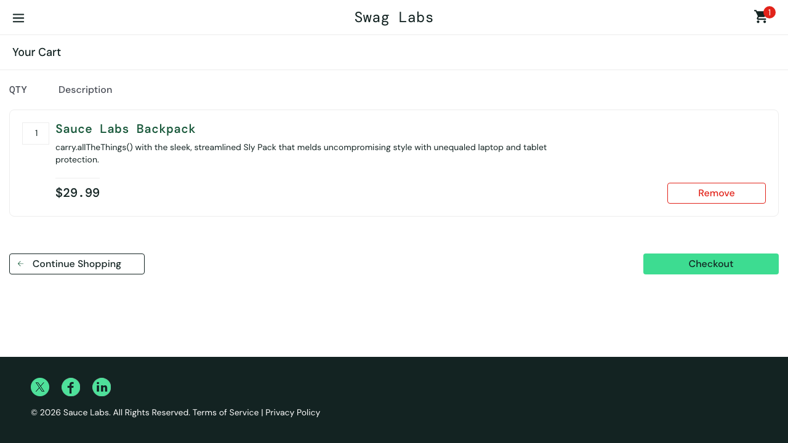

# SauceDemo E2E Automation

End-to-end UI tests for [SauceDemo](https://www.saucedemo.com/) using **Java 21, Playwright, Cucumber (BDD), JUnit 5 and Gradle**.

## Project structure

```
src/main/java/com/saucedemo/
  config/      Config (.env loader), PlaywrightManager
  pages/       Page objects (Login, Inventory, Cart, Checkout...)
  reporting/   Custom Playwright HTML report generator
src/test/java/com/saucedemo/
  hooks/ stepdefinitions/ runners/ context/
src/test/resources/features/e2e_purchase.feature
docs/reports/  Published test reports
```

## Setup

1. Install JDK 21 (e.g. `brew install openjdk@21`) and set `JAVA_HOME`.
2. Copy the env file: `cp .env.example .env`
3. Install browsers: `./gradlew playwrightInstall`

### Configuration (`.env`)

| Variable | Default | Description |
|---|---|---|
| `BASE_URL` | `https://www.saucedemo.com/` | Application under test |
| `BROWSER` | `chromium` | `chromium`, `firefox`, `webkit`, `chrome`, `edge` |
| `HEADLESS` | `true` | `false` opens a visible browser |
| `DEFAULT_TIMEOUT_MS` | `15000` | Playwright default timeout |

Precedence: `-D` system property > OS env var > `.env` > default.

## Running tests

```bash
./gradlew test                              # headless
./gradlew test -Dheadless=false             # headed (visible browser)
./gradlew test -Dbrowser=firefox
./gradlew test -Dcucumber.filter.tags=@smoke
./gradlew showTrace                         # open Playwright Trace Viewer
```

## Test report

Latest run: **1 scenario, 13 steps, all passed** (Chromium, headed and headless).

| Scenario | Tags | Status |
|---|---|---|
| Standard user completes an end-to-end purchase | `@e2e @smoke` | ✅ PASSED |

Published reports (open in a browser):

- [Playwright report](docs/reports/playwright-report.html) – step timeline, screenshot, video and trace links
- [Cucumber report](docs/reports/cucumber-report.html)



Reports are regenerated on every run under `build/reports/` (git-ignored). To republish, copy them into `docs/reports/`:

```bash
cp build/reports/playwright/index.html docs/reports/playwright-report.html
cp build/reports/cucumber/cucumber.html docs/reports/cucumber-report.html
```

## Bug report

### BUG-001: Cart contents are shared between `standard_user` and `problem_user`

| Field | Detail |
|---|---|
| **Application** | https://www.saucedemo.com/ |
| **Severity** | High |
| **Priority** | Medium |
| **Type** | Functional / Data isolation |
| **Environment** | Chromium (Playwright), macOS |
| **Status** | Open |

**Summary**
Items added to the cart while logged in as `standard_user` are also visible in the cart when logging in as `problem_user`. Carts should be isolated per user session.

**Preconditions**
- Valid credentials: `standard_user` / `secret_sauce` and `problem_user` / `secret_sauce`.

**Steps to reproduce**
1. Open https://www.saucedemo.com/.
2. Log in as `standard_user`.
3. Add "Sauce Labs Backpack" to the cart (badge shows 1).
4. Without clearing browser storage, log out via the menu.
5. Log in as `problem_user`.
6. Observe the cart badge and open the cart.

**Expected result**
`problem_user` starts with an empty cart (no badge, no items).

**Actual result**
The cart badge shows the item added by `standard_user`, and "Sauce Labs Backpack" is listed in `problem_user`'s cart.

**Impact**
Cart data leaks across user accounts on the same browser, so a user may see or purchase items they never added. This is a data isolation and privacy concern.

**Notes / suspected cause**
The cart appears to be persisted in browser storage (e.g. `localStorage`) keyed globally rather than per user, and it is not cleared on logout.

**Evidence (reproduced, Chromium)**

| Step | Screenshot |
|---|---|
| 1. `standard_user` logged in, empty cart |  |
| 2. Backpack added, badge shows 1 |  |
| 3. `standard_user` cart contains Backpack |  |
| 4. Logged out, logged in as `problem_user` – badge already shows 1 |  |
| 5. `problem_user` cart contains `standard_user`'s Backpack |  |

Re-capture the evidence with `./gradlew captureBug001` (add `-Dheadless=false` to watch). Console output of the last run: `problem_user cart badge=1 items=Sauce Labs Backpack`.
